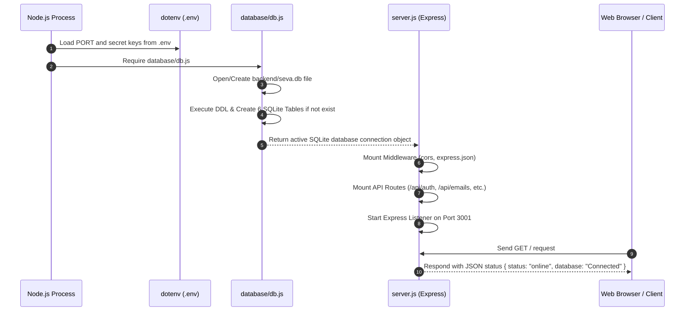

# SEVA Study Notes — Phase 1: Foundation

---

## 🔑 Key Concepts Highlighted

> [!IMPORTANT]
> * **Express.js**: Fast, unopinionated web server framework for Node.js used to build REST API endpoints.
> * **SQLite**: Serverless, self-contained, single-file relational database running 100% locally on your machine.
> * **better-sqlite3**: Synchronous, high-performance SQLite driver for Node.js that eliminates complex async callback/promise overhead.
> * **Module System**: CommonJS (`require` and `module.exports`) mechanism used to organize Node.js code into reusable files.

---

## 1. What is Phase 1 and Why We Did It

**One-line definition:** Phase 1 builds the foundational architecture, database schema, and server boilerplate required before adding integrations or AI logic.

### Detailed Explanation:
Before building integrations (like Gmail OAuth) or complex AI engines, a software application needs a rock-solid foundation. Phase 1 sets up:
* **The Project Folder Structure**: Organized separation of backend entry points, database logic, route handlers, and service modules.
* **The Local Database**: Initializing SQLite file `seva.db` and creating all 6 core tables.
* **The Web Server**: Setting up Express.js on port `3001` with CORS and JSON parsing middleware.
* **Security & Environment Config**: Creating `.env` for secrets and `.gitignore` to prevent committing sensitive keys or database files to GitHub.

---

## 2. What is Express.js

**One-line definition:** Express.js is a lightweight Node.js web application framework used to route HTTP requests and handle REST APIs.

### How Express Works & Why We Used It:
Express listens on a specific network port (e.g., `3001`). When a client (like a browser or React frontend) sends an HTTP request (such as `GET /` or `POST /api/tasks`), Express matches the request URL and method to a handler function (called a route) and sends back a response (usually JSON).

### Why We Used It:
* Lightweight and fast.
* Standard backend framework for modern Node.js development.
* Built-in support for middleware like `cors()` and `express.json()`.

```javascript
// Small Code Example: Basic Express Server
const express = require('express');
const app = express();

app.use(express.json()); // Parses incoming JSON payloads

app.get('/api/health', (req, res) => {
  res.json({ status: 'ok' });
});

app.listen(3001, () => {
  console.log('Server running on port 3001');
});
```

---

## 3. What is SQLite (Comparison with MongoDB & MySQL)

**One-line definition:** SQLite is a self-contained, serverless database engine that stores all data inside a single local file on disk.

### Comparison:

| Feature | SQLite | MySQL / PostgreSQL | MongoDB |
| :--- | :--- | :--- | :--- |
| **Architecture** | File-based (embedded) | Client-Server process | Document/NoSQL database |
| **Setup Required** | Zero setup (just a `.db` file) | Requires separate installed server process | Requires MongoDB server / Cloud cluster |
| **Data Format** | Relational (Tables, Columns, Rows) | Relational (Tables, Columns, Rows) | JSON-like Documents (BSON) |
| **Privacy & Cloud** | 100% Local on user's machine | Usually hosted on server/cloud | Usually hosted on server/cloud |

### Why We Chose SQLite for SEVA:
SEVA is designed to be a **privacy-first, local-only personal assistant**. SQLite requires no external server setup, runs entirely inside the Node.js process, and keeps 100% of user data strictly on their own machine inside `seva.db`.

---

## 4. What is `better-sqlite3`

**One-line definition:** `better-sqlite3` is the fastest and simplest SQLite library for Node.js that executes database queries synchronously.

### How It Works:
Unlike traditional Node.js database drivers that require `async/await` or callbacks for every query, `better-sqlite3` runs synchronously because SQLite reads directly from the local file system without network latency. This makes code clean, reliable, and extremely fast.

```javascript
// Small Code Example: better-sqlite3 usage
const Database = require('better-sqlite3');
const db = new Database('seva.db');

// Execute DDL (schema creation)
db.exec('CREATE TABLE IF NOT EXISTS users (id INTEGER PRIMARY KEY, name TEXT)');

// Query multiple rows
const allUsers = db.prepare('SELECT * FROM users').all();
```

---

## 5. What is `module.exports` (CommonJS Modules)

**One-line definition:** `module.exports` is the built-in Node.js CommonJS object used to export functions, objects, or variables from one file so they can be imported in another file using `require()`.

### How Node.js Modules Work:
Each JavaScript file in Node.js has its own private scope. To make code reusable across files:
1. Export values in the source file using `module.exports = ...`
2. Import values in the destination file using `const ... = require('./path/to/file')`

```javascript
// File 1: database/db.js
const Database = require('better-sqlite3');
const db = new Database('seva.db');
module.exports = db; // Exports the single DB connection

// File 2: server.js
const db = require('./database/db'); // Imports the DB connection
```

---

## 6. What is `path.join` and `__dirname`

**One-line definition:** `__dirname` gives the absolute directory path of the current file, and `path.join()` safely joins multiple path segments together into a single normalized file path across Windows, macOS, and Linux.

### Why We Need It:
Windows uses backslashes (`\`) for file paths (e.g., `C:\SEVA\backend`), whereas macOS/Linux use forward slashes (`/`). Using `path.join()` prevents broken path errors across operating systems.

```javascript
const path = require('path');

// Safe, cross-platform path resolution
const dbPath = path.join(__dirname, '..', 'seva.db');
// Result on Windows: "C:\SEVA\backend\seva.db"
```

---

## 7. What is `db.pragma('foreign_keys = ON')`

**One-line definition:** `db.pragma('foreign_keys = ON')` enables relational foreign key constraint checks in SQLite.

### What It Does:
By default, SQLite disables foreign key enforcement for backward compatibility. Enabling foreign keys ensures relational data integrity (e.g., preventing a task from linking to a non-existent email ID).

```javascript
const db = new Database('seva.db');
db.pragma('foreign_keys = ON'); // Enforces foreign key constraints
```

---

## 8. What is `CREATE TABLE IF NOT EXISTS`

**One-line definition:** `CREATE TABLE IF NOT EXISTS` is an SQL statement that creates a database table only if it does not already exist in the database.

### Why It Is Important:
Every time the SEVA backend server restarts, `db.js` runs. Using `IF NOT EXISTS` prevents SQLite from throwing an error (`table already exists`) on server restarts, ensuring idempotent execution.

---

## 9. Explanation of Every Column in All 6 Tables

### Table 1: `emails` (Stores Gmail emails & AI classification)
* `id` (`INTEGER PRIMARY KEY AUTOINCREMENT`): Unique numeric ID for each database row.
* `gmail_message_id` (`TEXT UNIQUE`): Gmail's unique message ID (e.g., `18e47b39a...`) used for 100% accurate deduplication.
* `subject` (`TEXT`): Email subject line.
* `sender` (`TEXT`): Sender email address and display name.
* `body_preview` (`TEXT`): Plain-text snippet (~300 characters) of the email body.
* `event_type` (`TEXT`): AI detected category (`meeting`, `deadline`, `opportunity`, `general`).
* `priority` (`TEXT`): AI detected urgency (`high`, `medium`, `low`).
* `summary` (`TEXT`): AI generated one-line summary.
* `date` (`TEXT`): Date email was received (`YYYY-MM-DD`).
* `accepted` (`INTEGER DEFAULT 0`): Status flag (`0 = pending`, `1 = accepted into day plan`, `2 = dismissed`).

### Table 2: `tasks` (Stores user tasks & email tasks)
* `id` (`INTEGER PRIMARY KEY AUTOINCREMENT`): Unique task ID.
* `name` (`TEXT`): Task description or title.
* `priority` (`TEXT`): Urgency level (`high`, `medium`, `low`).
* `time_slot` (`TEXT`): Scheduled time (e.g., `'9:00 AM'`).
* `source` (`TEXT`): Origin of task (`'email'` or `'manual'`).
* `completed` (`INTEGER DEFAULT 0`): Completion flag (`0 = pending`, `1 = completed`).
* `date` (`TEXT`): Task scheduled date (`YYYY-MM-DD`).
* `carry_forward` (`INTEGER DEFAULT 0`): Flag (`1` if missed yesterday and moved to today).

### Table 3: `day_plans` (Stores AI generated day plans)
* `id` (`INTEGER PRIMARY KEY AUTOINCREMENT`): Unique plan ID.
* `date` (`TEXT`): Plan date (`YYYY-MM-DD`).
* `plan_json` (`TEXT`): Complete hour-by-hour day schedule stored as a JSON string.
* `generated_at` (`DATETIME`): Timestamp when AI created the plan.
* `completed_count` (`INTEGER DEFAULT 0`): Number of completed tasks for that day.
* `missed_count` (`INTEGER DEFAULT 0`): Number of missed tasks for that day.

### Table 4: `chat_history` (Stores permanent user conversation with SEVA)
* `id` (`INTEGER PRIMARY KEY AUTOINCREMENT`): Unique chat message ID.
* `date` (`TEXT`): Conversation date (`YYYY-MM-DD`).
* `role` (`TEXT`): Speaker role (`'user'` or `'assistant'`).
* `message` (`TEXT`): Actual text message content.
* `timestamp` (`DATETIME DEFAULT CURRENT_TIMESTAMP`): Exact date & time message was sent.

### Table 5: `night_summary` (Stores daily review & performance streak)
* `id` (`INTEGER PRIMARY KEY AUTOINCREMENT`): Unique summary ID.
* `date` (`TEXT`): Review date (`YYYY-MM-DD`).
* `completed_tasks` (`TEXT`): List of completed tasks stored as text/JSON.
* `missed_tasks` (`TEXT`): List of missed tasks stored as text/JSON.
* `carry_forward` (`TEXT`): List of tasks carried forward to tomorrow.
* `seva_message` (`TEXT`): AI encouraging/honest end-of-day feedback message.
* `streak` (`INTEGER DEFAULT 0`): Number of consecutive productivity streak days.

### Table 6: `timetable` (Stores recurring weekly class/work timetable)
* `id` (`INTEGER PRIMARY KEY AUTOINCREMENT`): Unique timetable slot ID.
* `day_of_week` (`TEXT`): Day name (`'Monday'`, `'Tuesday'`, etc.).
* `subject` (`TEXT`): Subject/Course name (e.g., `'Database Engineering'`).
* `start_time` (`TEXT`): Slot start time (e.g., `'10:15 AM'`).
* `end_time` (`TEXT`): Slot end time (e.g., `'11:15 AM'`).

---

## 10. Key SQL Constraints Explained

### What is `INTEGER PRIMARY KEY AUTOINCREMENT`
It automatically generates a unique incremental integer ID (1, 2, 3...) for each new row inserted into the table.

### What is `DEFAULT 0` and `DEFAULT CURRENT_TIMESTAMP`
* `DEFAULT 0`: Assigns a default numerical value of `0` if no value is explicitly provided during row insertion (used for flags like `completed`, `accepted`, `streak`).
* `DEFAULT CURRENT_TIMESTAMP`: Automatically inserts the current system date and time into the column upon row creation.

---

## 11. How `db.prepare().run()` and `db.prepare().all()` Work

**One-line definition:** `prepare()` compiles an SQL query into a prepared statement, `.run()` executes write operations (INSERT, UPDATE, DELETE), and `.all()` executes read operations (SELECT).

```javascript
// 1. Write Operation using .run()
const insertStmt = db.prepare(`
  INSERT INTO tasks (name, priority, date) VALUES (?, ?, ?)
`);
const result = insertStmt.run('Study Database Systems', 'high', '2026-09-18');
console.log('Inserted Row ID:', result.lastInsertRowid);

// 2. Read Operation using .all()
const selectStmt = db.prepare('SELECT * FROM tasks WHERE date = ?');
const todayTasks = selectStmt.all('2026-09-18'); // Returns Array of Objects
```

---

## 12. Complete Flow — Step by Step Server Startup



## 13. Top Interview Questions & Detailed Answers — Phase 1

### Q1: Why choose SQLite over client-server databases like PostgreSQL or MySQL for SEVA?
**Answer:**
1. **Privacy-First Architecture**: SEVA is a local-first AI assistant. Storing data in PostgreSQL/MySQL requires running a separate network service daemon or hosting data on an external cloud database. SQLite stores everything inside a single local file (`backend/seva.db`), ensuring 100% data ownership remains on the user's machine.
2. **Zero Configuration**: SQLite requires no installation, configuration, user management, or port mapping.
3. **Low Memory Footprint**: Running an active PostgreSQL/MySQL server process consumes 100MB+ RAM continuously. SQLite runs inside Node.js memory space with minimal footprint.

### Q2: Why did we use `better-sqlite3` instead of the traditional `sqlite3` asynchronous library in Node.js?
**Answer:**
1. **No Asynchronous Overhead**: SQLite is a file-based database operating directly on the local filesystem without network I/O latency. Wrapping disk access in asynchronous Promises/callbacks introduces unnecessary event loop scheduling overhead.
2. **Synchronous Execution Model**: `better-sqlite3` executes queries synchronously, producing cleaner, deterministic code without `async/await` boilerplate.
3. **Benchmark Performance**: `better-sqlite3` is up to 10x faster than traditional async Node SQLite wrappers for single-thread operations because it accesses SQLite C-bindings directly.

### Q3: What happens if `db.pragma('foreign_keys = ON')` is omitted in SQLite?
**Answer:**
By default, SQLite disables foreign key enforcement for backward compatibility with legacy databases. If omitted:
* SQLite will allow inserting child records with foreign keys that do not exist in the parent table.
* Deleting a parent record will not trigger cascading deletes on child records, causing orphaned data.
Enabling `db.pragma('foreign_keys = ON')` ensures strict relational integrity.

### Q4: How does Node.js handle module caching when `require('./database/db')` is imported in multiple files?
**Answer:**
Node.js uses a **Singleton Module Caching Mechanism** (`require.cache`). The first time `require('./database/db')` is invoked in `server.js`, Node executes `db.js`, connects to `seva.db`, creates tables, and caches the exported object in memory. Subsequent `require('./database/db')` calls across other files (e.g., `routes/gmail.js`) return the cached database instance instantly without creating multiple database connections or re-executing `db.js`.

### Q5: Explain the difference between `db.prepare().run()`, `db.prepare().get()`, and `db.prepare().all()` in `better-sqlite3`.
**Answer:**
* **`.run(...params)`**: Executed for data modification queries (`INSERT`, `UPDATE`, `DELETE`). Returns an info object `{ changes: number, lastInsertRowid: number }`.
* **`.get(...params)`**: Executed for read queries (`SELECT`) where at most one single row is expected. Returns a single JavaScript object (or `undefined` if no match).
* **`.all(...params)`**: Executed for read queries (`SELECT`) where multiple rows are expected. Returns an Array of JavaScript objects matching the query.

---
*End of Phase 1 Study Notes*

