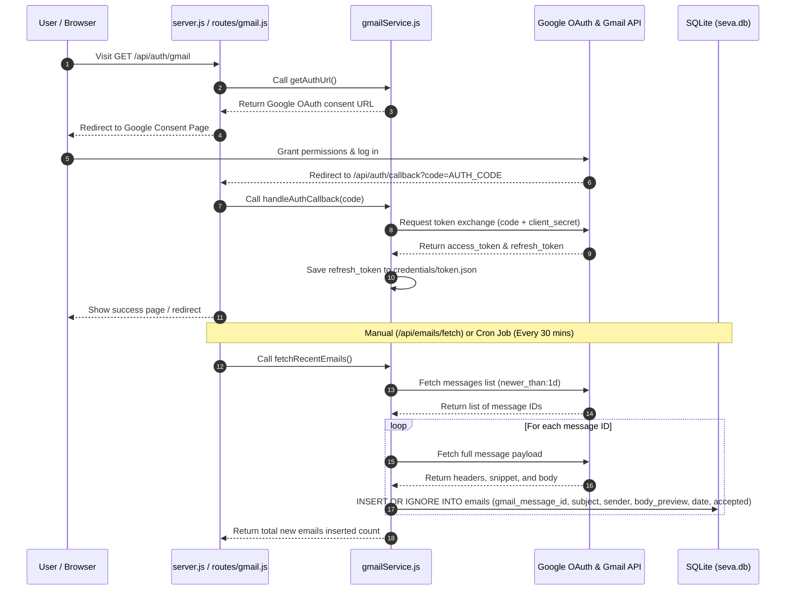

# SEVA Study Notes — Phase 2: Gmail Connection

---

## 🔑 Key Concepts Highlighted

> [!IMPORTANT]
> * **OAuth 2.0**: Secure token-based authorization framework allowing SEVA to read Gmail emails without storing user passwords.
> * **Gmail API**: Google's RESTful API for searching, fetching, and reading user emails.
> * **Token Management**: Access token for short-term API requests; Refresh token saved on disk (`credentials/token.json`) for seamless background auto-login.
> * **Cron Scheduler (`node-cron`)**: Automated background job runner executing email sync every 30 minutes.

---

## 1. What is OAuth 2.0 and How It Works

**One-line definition:** OAuth 2.0 is an industry-standard protocol that allows a third-party application (SEVA) to access user data (Gmail) with user consent without ever accessing or storing the user's password.

### Step-by-Step OAuth 2.0 Workflow:
1. **User clicks login**: Client accesses `http://localhost:3001/api/auth/gmail`.
2. **Redirect to Google**: Server redirects user to Google's consent screen.
3. **User grants consent**: User logs in with Gmail and approves read-only access.
4. **Authorization Code issued**: Google redirects back to `http://localhost:3001/api/auth/callback?code=4/0A...` with a temporary code.
5. **Token Exchange**: SEVA backend sends the secret `code` to Google's token endpoint.
6. **Tokens Issued**: Google returns an **Access Token** and a **Refresh Token**.
7. **Token Storage**: SEVA saves the `refresh_token` securely into `backend/credentials/token.json`.

```javascript
// Small Code Example: Generating OAuth Consent URL
const { google } = require('googleapis');

const oauth2Client = new google.auth.OAuth2(
  process.env.GOOGLE_CLIENT_ID,
  process.env.GOOGLE_CLIENT_SECRET,
  process.env.GOOGLE_REDIRECT_URI
);

const authUrl = oauth2Client.generateAuthUrl({
  access_type: 'offline', // Requests refresh_token
  prompt: 'consent',     // Ensures refresh_token is returned
  scope: ['https://www.googleapis.com/auth/gmail.readonly']
});
```

---

## 2. What is Google Cloud Console & What We Did There

**One-line definition:** Google Cloud Console is Google's developer portal used to register applications, enable APIs, configure OAuth consent screens, and issue API credentials.

### What We Did in Google Cloud Console:
1. **Created Project**: Named `SEVA`.
2. **Enabled API**: Enabled **Gmail API** so SEVA is allowed to call Gmail endpoints.
3. **Configured OAuth Consent Screen**: Set User Type to *External*, added user support email, defined scopes (`gmail.readonly`), and added test user email addresses.
4. **Created Credentials**: Generated OAuth 2.0 Client ID for a *Web Application* and specified Authorized Redirect URI (`http://localhost:3001/api/auth/callback`).
5. **Downloaded JSON**: Downloaded `client_secret.json` into `backend/credentials/`.

---

## 3. What is Client ID, Client Secret, and Redirect URI

* **Client ID**: A public unique identifier (like a username) that identifies the SEVA application to Google.
* **Client Secret**: A secret password key shared only between SEVA backend and Google to verify SEVA's identity.
* **Redirect URI**: The exact URL (`http://localhost:3001/api/auth/callback`) Google sends the user and authorization code back to after authentication completes.

---

## 4. What is `googleapis` NPM Package

**One-line definition:** `googleapis` is the official Node.js client library provided by Google for interacting with Google APIs (including Gmail OAuth2 and Gmail REST APIs).

```javascript
// Usage Example
const { google } = require('googleapis');
const gmail = google.gmail({ version: 'v1', auth: oauth2Client });

// List messages from last 24 hours
const response = await gmail.users.messages.list({
  userId: 'me',
  q: 'newer_than:1d',
  maxResults: 20
});
```

---

## 5. Access Token vs. Refresh Token

**One-line definition:** An access token is a short-lived key (valid for ~1 hour) used to make API calls, while a refresh token is a long-lived key saved on disk used to obtain new access tokens automatically.

| Token Type | Lifespan | Stored Location | Purpose |
| :--- | :--- | :--- | :--- |
| **Access Token** | 1 Hour | In-memory | Sent in HTTP header to authorize Gmail API calls |
| **Refresh Token** | Days / Months | `credentials/token.json` | Used in background to fetch fresh access tokens without user re-login |

---

## 6. Gmail Scopes & Why We Used `gmail.readonly`

**One-line definition:** Scopes specify the exact permissions an application requests from a user's Google account.

### Why `gmail.readonly` Was Used:
* **Scope Requested**: `https://www.googleapis.com/auth/gmail.readonly`
* **Permissions**: Grants permission to **read** email messages and metadata ONLY.
* **Privacy & Security**: SEVA **never** requests `gmail.send`, `gmail.modify`, or `gmail.compose`. SEVA cannot modify, delete, or send emails on behalf of the user.

---

## 7. How Email Fetch Works & Fields Extracted

### Extraction Logic:
1. `gmail.users.messages.list()` fetches message IDs from the last 24 hours (`q: 'newer_than:1d'`).
2. `gmail.users.messages.get()` fetches full message payload for each ID.
3. Extracted fields:
   * `gmail_message_id`: Unique Gmail ID (`msg.id`).
   * `subject`: Extracted from email headers (`Subject`).
   * `sender`: Extracted from email headers (`From`).
   * `date`: Extracted from `Date` header or converted to `YYYY-MM-DD`.
   * `body_preview`: Plain-text preview snippet (~300 characters).
   * `event_type`, `priority`, `summary`: Set to `NULL` (awaiting Phase 3 AI processing).

---

## 8. What is `body_preview` and Why We Don't Store Full Email Body

**One-line definition:** `body_preview` is the first 300 plain-text characters of an email, stripped of HTML tags and formatting.

### Why We Don't Store Full Email Body:
* **Database Performance**: Full emails contain huge HTML, CSS, inline images, and base64 strings that bloat SQLite.
* **Token Economy**: AI models (Ollama TinyLlama) perform best when given concise text previews rather than full 10,000-character HTML pages.
* **Privacy**: Storing minimal text previews minimizes stored personal data.

---

## 9. What is `node-cron` & Cron Schedule Syntax (`*/30 * * * *`)

**One-line definition:** `node-cron` is a task scheduler for Node.js that runs functions automatically on a recurring schedule using standard Unix cron syntax.

### Cron Syntax Breakdown (`*/30 * * * *`):

```text
┌───────────── minute (0 - 59) -> */30 means "every 30 minutes"
│ ┌─────────── hour (0 - 23) -> * means "every hour"
│ │ ┌───────── day of month (1 - 31) -> * means "every day"
│ │ │ ┌─────── month (1 - 12) -> * means "every month"
│ │ │ │ ┌───── day of week (0 - 6) -> * means "every day of week"
│ │ │ │ │
* * * * *
```

```javascript
// Small Code Example: node-cron usage
const cron = require('node-cron');

// Runs every 30 minutes
cron.schedule('*/30 * * * *', async () => {
  console.log('Running 30-minute automated Gmail sync...');
  await gmailService.fetchRecentEmails();
});
```

---

## 10. How Emails are Stored in SQLite & The `accepted` Field

Emails are stored in the `emails` table using `INSERT OR IGNORE INTO emails` with `gmail_message_id TEXT UNIQUE`. If an email message ID already exists in SQLite, the row insert is skipped automatically.

### The `accepted` Field Values Explained:
* `0` (**Pending**): Default state when email is fetched. User hasn't acted on it yet.
* `1` (**Accepted**): User approved the email event, and it has been converted into a task in the Day Plan.
* `2` (**Dismissed**): User dismissed/ignored the email event.

---

## 11. Complete Flow — From Login to Email Storage



## 12. Top Interview Questions & Detailed Answers — Phase 2

### Q1: Explain the security flaw in storing email passwords directly versus using OAuth 2.0 Authorization Code Flow.
**Answer:**
1. **Password Exposure Risk**: Storing user passwords directly exposes plaintext or hashed credentials to data breaches, application logs, and unauthorized access.
2. **Scope Granularity**: Passwords grant unrestricted account access (sending, deleting, account settings). OAuth 2.0 allows requesting restricted, granular scopes (e.g., `gmail.readonly` only).
3. **Revocation & Expiration**: Users can revoke an OAuth grant instantly from their Google Security Dashboard without changing their email password.
4. **Third-Party Compliance**: Google forbids third-party apps from handling raw Google passwords, requiring OAuth 2.0 for security compliance.

### Q2: What is the difference between an Access Token and a Refresh Token, and why must the Refresh Token be stored securely on disk?
**Answer:**
* **Access Token**: Short-lived (typically 1 hour) bearer token passed in the HTTP Authorization header (`Authorization: Bearer <TOKEN>`) to authorize Gmail API calls. Because it expires quickly, its exposure risk is minimal.
* **Refresh Token**: Long-lived credential returned only during initial user consent (`access_type: 'offline'`, `prompt: 'consent'`). It is used in background processes to request new access tokens automatically when old ones expire.
* **Storage Requirement**: The refresh token is saved on disk in `credentials/token.json` (gitignored). If an attacker gets the refresh token, they can generate new access tokens indefinitely until the user manually revokes app access in Google settings.

### Q3: Why did we request the scope `https://www.googleapis.com/auth/gmail.readonly` instead of full Gmail access?
**Answer:**
1. **Principle of Least Privilege**: Software should only request the minimum permissions required to perform its function. SEVA only needs to read incoming emails to extract tasks and events.
2. **Security Blast Radius**: Using read-only scope guarantees that even if the backend application is compromised, an attacker cannot delete emails, modify user settings, or send spam emails.
3. **User Trust & Consent**: Users are significantly more willing to approve read-only access than full read/write/delete account access.

### Q4: How does email deduplication work when fetching emails periodically with `node-cron`, and why is `gmail_message_id` essential?
**Answer:**
Every email in Gmail has an immutable, globally unique hexadecimal identifier (`msg.id`, e.g. `18e47b39a82c1b4f`).
1. We altered the SQLite `emails` table to include `gmail_message_id TEXT` and created a unique index `idx_emails_gmail_message_id`.
2. When inserting emails, we execute:
   `INSERT OR IGNORE INTO emails (gmail_message_id, subject, sender, body_preview, date) VALUES (?, ?, ?, ?, ?)`
3. If `node-cron` runs every 30 minutes, SQLite checks the unique index. If `gmail_message_id` already exists, SQLite silently skips insertion (`changes = 0`), preventing duplicate rows. Matching by subject/date alone is unreliable because users frequently receive multiple emails with identical subjects or senders.

### Q5: Explain how `node-cron` schedules background tasks without blocking the main Node.js Event Loop.
**Answer:**
1. **Event Loop Non-Blocking**: `node-cron` uses Node.js internal timer facilities (`setTimeout` and `setInterval`) to schedule task evaluations. It registers a lightweight timer event in the V8 Event Loop without running a blocking while-loop.
2. **Cron Expression Parsing**: The cron parser evaluates `*/30 * * * *` and calculates the exact millisecond delay until the next 30-minute boundary.
3. **Async Error Isolation**: Inside the cron callback, async operations are wrapped in `try/catch` blocks. If an email fetch error occurs during a background cron execution (e.g. network failure), the error is caught and logged to console without crashing the Express web server process listening on port 3001.

---
*End of Phase 2 Study Notes*