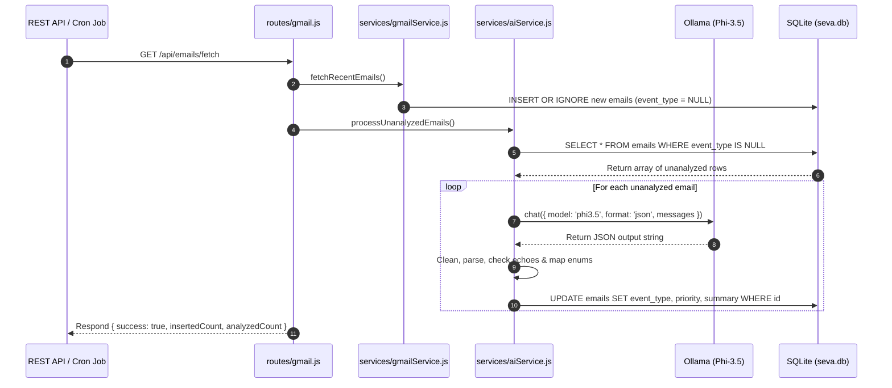

# SEVA Study Notes — Phase 3: AI Integration (Email Intelligence)

---

## 🔑 Key Concepts Highlighted

> [!IMPORTANT]
> * **Local LLM (Phi-3.5 via Ollama)**: 100% private, locally-run language model running on the user's machine without external cloud API calls.
> * **Structured JSON Decoding (`format: 'json'`)**: Enforces syntactic JSON structure at the model sampling level to prevent broken syntax.
> * **Validation Guards & Recovery**: Multi-tier defense layer (strip-braces recovery, prompt placeholder-echo detection, case normalization, and synonym mapping) to handle LLM edge cases.
> * **Sequential Processing**: Processing unanalyzed emails sequentially (one by one) to avoid local CPU/GPU memory saturation.

---

## 1. What is Phase 3 and Why We Built It

**One-line definition:** Phase 3 integrates a local AI model (Phi-3.5 via Ollama) to automatically read raw fetched emails from SQLite, extract structured JSON metadata (`event_type`, `priority`, `time`, `summary`), and save the intelligence back to the database.

### Detailed Explanation:
In Phase 2, we fetched emails from Gmail and stored their `subject`, `sender`, `body_preview`, and `date` in SQLite, but `event_type`, `priority`, and `summary` were left `NULL`. In Phase 3:
* We connected Node.js to Ollama's local `phi3.5` model.
* We built an AI email classification service (`aiService.js`).
* We created a robust parsing & validation pipeline to ensure AI outputs never crash the application.
* We automated the fetch-and-analyze workflow in both REST endpoints and 30-minute `node-cron` background tasks.

---

## 2. Model Selection: TinyLlama vs. Phi-3.5

**One-line definition:** Model benchmark testing proved that Microsoft's `phi3.5` achieved 100% precision for email classification compared to `tinyllama`.

### Side-by-Side Comparison Summary:

| Feature / Criteria | TinyLlama (1.1B) | Phi-3.5 (3.8B) |
| :--- | :--- | :--- |
| **Model Size** | ~637 MB | ~2.2 GB |
| **JSON Reliability** | Occasional stray text & placeholder echoes | 100% Valid JSON |
| **Classification Accuracy** | ~40% (mislabeled deadlines/opportunities) | 100% (5/5 perfect test score) |
| **Time Extraction** | Partial / Vague | Exact (`"Friday at 11:59 PM"`) |
| **Decision** | Replaced | **Standardized as Primary Model** |

---

## 3. How Ollama Node.js Client Works

**One-line definition:** The `ollama` npm client communicates with the background Ollama daemon via local REST HTTP calls (`http://localhost:11434`).

```javascript
// Small Code Example: Ollama Node.js Chat Call
const ollama = require('ollama').default || require('ollama');

const response = await ollama.chat({
  model: 'phi3.5',
  format: 'json', // Enforces structured JSON output
  messages: [
    { role: 'system', content: 'You are an AI email analyzer. Output ONLY JSON.' },
    { role: 'user', content: 'Subject: Team Sync Meeting\nBody: Meeting at 3 PM tomorrow' }
  ]
});

console.log(response.message.content);
```

---

## 4. Multi-Tiered AI Resilience & Parsing Recovery Strategy

Even when using `format: 'json'`, language models can occasionally output unexpected keys or echo prompt instructions. SEVA implements a **4-layer resilience strategy**:

### Layer 1: JSON Substring Extraction (`extractJsonString`)
Extracts content between the first `{` and last `}` to strip any leading or trailing text.

```javascript
function extractJsonString(rawText) {
  const firstBrace = rawText.indexOf('{');
  const lastBrace = rawText.lastIndexOf('}');
  if (firstBrace !== -1 && lastBrace !== -1 && lastBrace > firstBrace) {
    return rawText.substring(firstBrace, lastBrace + 1);
  }
  return null;
}
```

### Layer 2: Prompt Placeholder-Echo Detection (`containsPlaceholderEcho`)
Guards against the model echoing template strings (like `"extracted time"` or `"under 15 words"`).

### Layer 3: Case Normalization & Synonym Mapping (`normalizeEventType`)
Coerces model outputs into allowed database enums (`meeting`, `deadline`, `opportunity`, `general`). Maps synonyms like `"assignment"` or `"due date"` directly to `"deadline"`.

```javascript
const EVENT_TYPE_SYNONYMS = {
  'assignment': 'deadline',
  'submission': 'deadline',
  'due': 'deadline',
  'sync': 'meeting',
  'interview': 'meeting',
  'internship': 'opportunity'
};
```

### Layer 4: Safe Default Fallback
If parsing fails completely, the function returns a safe default object (`general`, `medium`, `time: null`, `summary: subject`) without throwing an exception.

---

## 5. Body Extraction Fix (`getBodyPreview`)

**One-line definition:** Gmail notification emails (such as Google Classroom) often place redirect URLs and navigation headers at the top of the body. `getBodyPreview()` strips URLs and navigation boilerplate before storing previews.

```javascript
// Stripping URLs and navigation chrome
let cleanText = rawText
  .replace(/<https?:\/\/[^>]+>/gi, '')   // Remove <http...> URLs
  .replace(/https?:\/\/\S+/gi, '')       // Remove bare http URLs
  .replace(/Notification settings/gi, '') // Strip nav header text
  .replace(/Unsubscribe or change your settings/gi, '');
```

---

## 6. Sequential Email Processing (`processUnanalyzedEmails`)

**One-line definition:** `processUnanalyzedEmails()` queries all rows where `event_type IS NULL` and processes them sequentially in a `for...of` loop to prevent local hardware overload.

```javascript
async function processUnanalyzedEmails() {
  const unanalyzed = db.prepare('SELECT * FROM emails WHERE event_type IS NULL').all();
  const updateStmt = db.prepare('UPDATE emails SET event_type = ?, priority = ?, summary = ? WHERE id = ?');

  for (const email of unanalyzed) {
    const result = await analyzeEmail(email);
    updateStmt.run(result.event_type, result.priority, result.summary, email.id);
  }
  return unanalyzed.length;
}
```

---

## 7. Complete Flow — Email Fetch to AI Database Update



---

## 8. Top Interview Questions & Detailed Answers — Phase 3

### Q1: Why did we pass `format: 'json'` in the Ollama chat request?
**Answer:**
`format: 'json'` enables constrained decoding in Ollama. It restricts the language model's token sampling vocabulary during generation so that the output is guaranteed to be syntactically valid JSON. This eliminates common small-model issues like markdown code fences (` ```json `), unclosed braces, or conversational preamble text.

### Q2: Why process emails sequentially instead of using `Promise.all()` in parallel?
**Answer:**
Local LLMs (like Phi-3.5) consume significant CPU/GPU memory and compute resources. Executing 10 parallel requests via `Promise.all()` would spawn 10 concurrent inference calls in Ollama, causing extreme thread contention, high RAM usage, potential out-of-memory crashes, and high latency. Sequential processing (`for...of` loop with `await`) ensures stable, single-threaded execution that runs smoothly on standard user laptops.

### Q3: How do we prevent prompt placeholder text from polluting the database?
**Answer:**
Small LLMs can occasionally copy-paste placeholder strings from the system prompt (e.g. returning `"time": "extracted time string or null"`). SEVA implements a validation guard function `containsPlaceholderEcho()` that checks if `parsed.summary` or `parsed.time` contains substrings from the prompt template. If an echo is detected, the function treats it as a failed response and falls back to safe defaults.

### Q4: Why do we separate `time` extraction in AI logic when the `emails` table does not have a `time` column?
**Answer:**
The `emails` table schema stores email metadata (`subject`, `sender`, `body_preview`, `event_type`, `priority`, `summary`, `date`). However, `analyzeEmail()` extracts `time` in memory so that in Phase 4 (Planning Engine), the extracted time string (e.g. `"Friday at 11:59 PM"`) can be passed directly to `plannerService.js` to create scheduled task time-slots without requiring an unnecessary schema modification on the `emails` table.

### Q5: How does synonym mapping improve AI classification reliability?
**Answer:**
Prompt instructions ask for strict enums (`meeting`, `deadline`, `opportunity`, `general`). However, LLMs might output specific domain terms like `"assignment"` or `"interview"`. Synonym mapping (`normalizeEventType()`) maps known domain words (`'assignment'`, `'exam'`, `'quiz'`, `'homework'` $\rightarrow$ `'deadline'`) to standard database enums. This prevents valid classifications from being discarded to `'general'`.

---
*End of Phase 3 Study Notes*
